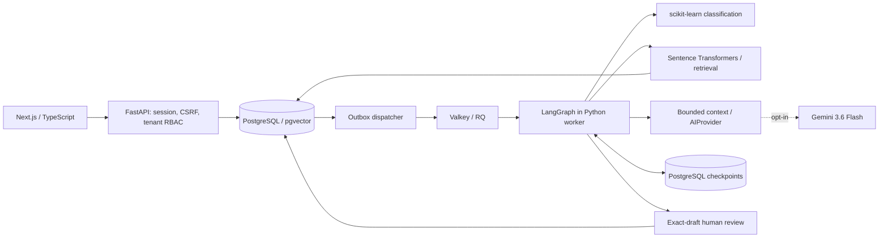

# ResolveFlow AI

ResolveFlow AI is a customer-support engineering project that combines ticket
management, real ML classification, semantic retrieval, grounded draft generation
and durable human review. It preserves source evidence and authorization across
background execution and recovery. Approval is internal: the application does not
send customer messages or perform refunds/account actions.

**[Explore the live recruiter demo](https://resolveflow-ai-rosy.vercel.app/demo)** ·
[Architecture](docs/SYSTEM_ARCHITECTURE_OVERVIEW.md) ·
[Engineering case study](docs/AI_ENGINEERING_CASE_STUDY.md) ·
[Three-minute walkthrough](docs/RECRUITER_WALKTHROUGH.md) ·
[Verified evidence](docs/PORTFOLIO_EVIDENCE.md)

## The project in 60 seconds

A support response needs a category, relevant evidence and an accountable decision.
ResolveFlow AI combines **trained ticket classification, semantic retrieval,
Gemini-powered RAG and LangGraph orchestration** in a multi-tenant application.
I built the ticket/document APIs, ML pipeline, retrieval and generation adapters,
checkpointed review workflow, background recovery and frontend.

The engineering challenge is preserving evidence and authorization when work is slow,
retried or interrupted. PostgreSQL outboxes and checkpoints, stable draft identities
and exact-draft human review address that challenge. Approval records an internal
review outcome; it does not send a customer message.

[Open the synthetic demo](https://resolveflow-ai-rosy.vercel.app/demo) →
**Explore a workflow** → inspect its source → **Under the hood**.
The local implementation runs real ML and retrieval; the public demo replays authored
examples with live Gemini disabled. See the [three-minute script](docs/RECRUITER_WALKTHROUGH.md)
and [resume / LinkedIn copy](docs/RESUME_PROJECT_SUMMARY.md).

## Two runtimes, clearly separated

| | Local full application | Hosted recruiter demo |
| --- | --- | --- |
| Backend | FastAPI, PostgreSQL/pgvector, dedicated Python workers | Standalone Next.js; no hosted Python backend |
| ML and retrieval | Trained scikit-learn classifier, local Sentence Transformers, actual pgvector search | Authored categories, fixed passages and keyword search |
| AI workflow | Real LangGraph transitions/checkpoints, bounded Gemini adapter; automated tests use deterministic generation | Precomputed drafts and authored stage replay; live AI disabled |
| Persistence | Database, private documents, durable jobs and review records | Synthetic edits in browser session storage |
| Purpose | Operator-controlled local development and engineering verification | Public, interactive portfolio demonstration |

The public demo requires no API key, database or local services. Do not enter private
information. Source remains private; the full application is preserved on `hardening/step20`.
The public production demo remains on `main`; Step 23 presentation edits are local only.
Commercial production SaaS readiness remains incomplete. See the
[mode-specific readiness matrix](docs/PRODUCTION_READINESS_MATRIX.md).

## Implemented capabilities

- Authentication, CSRF protection, workspace RBAC and tenant-scoped APIs; local
  invitation acceptance, email verification and password recovery through Mailpit.
- Tickets with assignment, filtering, optimistic versions, notes and activity history.
- Private PDF/TXT/Markdown ingestion, bounded extraction, deterministic chunks,
  local embeddings, source-linked semantic search and recoverable deletion.
- TF-IDF/logistic-regression category suggestions with abstention and explicit acceptance.
- Structured RAG drafts, actual source quotation checks and immutable exact-draft review.
- Seven-stage LangGraph orchestration, PostgreSQL checkpoints, RQ/Valkey workers,
  durable outbox reconciliation, bounded attempts and cooperative cancellation.
- Authorized analytics, content-free diagnostics and encrypted local backup/restore tools.

## Technology

Next.js / React / TypeScript / Tailwind CSS; Python / FastAPI / Pydantic;
SQLAlchemy / Alembic / PostgreSQL / pgvector; scikit-learn / Sentence Transformers;
Google Gen AI SDK behind `AIProvider`; LangGraph / PostgreSQL checkpointer;
Valkey (Redis protocol) / RQ; restic; Mailpit; Pytest / Playwright / Ruff / ESLint.

shadcn/ui and Vitest were in the original plan but are not installed implementations.
The [architecture overview](docs/SYSTEM_ARCHITECTURE_OVERVIEW.md) includes a Mermaid
diagram and source map; [ARCHITECTURE.md](docs/ARCHITECTURE.md) retains detailed
component and milestone notes.

## Architecture at a glance



This is the **local full application**, with server-side authorization rechecked
inside services and workers. Only generation can call Gemini; routine tests use a
fixture provider. The separate public demo has no backend connection. See the
[detailed diagram](docs/SYSTEM_ARCHITECTURE_OVERVIEW.md) for ingestion, private storage,
review/resume and operational boundaries.

## Local setup

The verified environment is Apple Silicon macOS, Python **3.14.6**, Node
**24.22.1** for the current builds, and PostgreSQL **18.6** with pgvector **0.8.6**.
The earlier `.nvmrc` records Node 26.5.0; the prepared Vercel/demo target is Node 24.x.
Dependencies are locked in `apps/web/package-lock.json` and `apps/api/uv.lock`.
No Docker, paid service or AI credential is needed for routine local tests.

From the repository root, with Node, npm and uv available:

```bash
(cd apps/web && npm ci --cache ../../.cache/npm)
(cd apps/api && UV_CACHE_DIR=../../.cache/uv uv sync --locked)
```

Follow [DATABASE.md](docs/DATABASE.md) for a fresh owned native database and
[WORKER_OPERATIONS.md](docs/WORKER_OPERATIONS.md) for native Valkey setup. Existing
checkout data uses PostgreSQL **127.0.0.1:55433** and Valkey **127.0.0.1:56379**.
Do not reset existing services or replace private settings with template placeholders.
Migrations through **0012** are already applied to this checkout. On another checkout,
review/backup before applying migrations and explicitly initialize checkpoint storage.

Train the classifier only when its selected artifact is missing or a new version is
intentionally needed. Download the pinned embedding snapshot once; inference then
loads locally. The existing `baseline-v1` artifact must not be overwritten.

```bash
(cd apps/api && UV_CACHE_DIR=../../.cache/uv uv run python scripts/classifier.py train --version baseline-v1)
(cd apps/api && UV_CACHE_DIR=../../.cache/uv uv run python scripts/download_embeddings.py)
```

Run these only as required by the [ML](docs/ML_CLASSIFICATION.md) and
[retrieval](docs/SEMANTIC_SEARCH.md) setup runbooks. Current local artifacts already exist.

### Start the configured full application

From `apps/api`, start the owned services:

```bash
export UV_CACHE_DIR=../../.cache/uv
uv run --locked python scripts/local_db.py start
uv run --locked python scripts/local_broker.py start
```

For a new or upgraded checkout, after the database safety review:

```bash
uv run --locked alembic upgrade head
uv run --locked python scripts/workflows.py setup
```

Run each of the following in a separate terminal from `apps/api`:

```bash
RESOLVEFLOW_AI_LIVE_ENABLED=false uv run --locked uvicorn resolveflow.main:app --app-dir src --host 127.0.0.1 --port 8000 --no-proxy-headers
RESOLVEFLOW_AI_LIVE_ENABLED=false uv run --locked python scripts/jobs.py dispatch
RESOLVEFLOW_AI_LIVE_ENABLED=false uv run --locked python scripts/jobs.py worker
```

Then, from the repository root:

```bash
NEXT_PUBLIC_APP_MODE=full API_INTERNAL_URL=http://127.0.0.1:8000 NEXT_TELEMETRY_DISABLED=1 npm --prefix apps/web run dev -- --webpack
```

Open [localhost:3000](http://127.0.0.1:3000) and register/sign in. Email delivery is
disabled unless explicitly configured; [EMAIL_DELIVERY.md](docs/EMAIL_DELIVERY.md)
provides loopback Mailpit commands and consistent API/dispatcher/worker settings.
Production requires verified email and rejects local proof. External SMTP and
production invitation delivery are not configured or verified.

`/api/v1/health` checks API liveness; `/api/v1/ready` checks DB connectivity only.
Use `uv run --locked python scripts/jobs.py health` for separate worker/broker checks.
Stop foreground processes with Ctrl+C, then stop only the owned broker/database
using their scripts' `stop` commands. Data is preserved.

### Run the standalone demo locally

```bash
npm --prefix apps/web run demo:build
npm --prefix apps/web run demo:start
```

Open [localhost:3200/demo](http://127.0.0.1:3200/demo). The scripts set
`NEXT_PUBLIC_APP_MODE=demo` and `DEMO_LIVE_AI_ENABLED=false`. Full and demo builds
share `.next`; rebuild when switching and never build both concurrently.
Vercel settings are documented in [VERCEL_RELEASE_READINESS.md](docs/VERCEL_RELEASE_READINESS.md).
These commands do not deploy.

## Verification

From the repository root, with the owned database, installed native test tools and
local embedding model available:

```bash
(cd apps/api && RESOLVEFLOW_AI_LIVE_ENABLED=false .venv/bin/python scripts/local_db.py test)
(cd apps/api && .venv/bin/ruff check . && .venv/bin/ruff format --check .)
NEXT_PUBLIC_APP_MODE=full NEXT_TELEMETRY_DISABLED=1 npm --prefix apps/web run build -- --webpack
npm --prefix apps/web run typecheck
npm --prefix apps/web run lint
(cd apps/api && NEXT_PUBLIC_APP_MODE=full RESOLVEFLOW_AI_LIVE_ENABLED=false .venv/bin/python scripts/test_browser.py)
npm --prefix apps/web run demo:build
npm --prefix apps/web run test:demo
```

The integration helpers create and remove ownership-marked test databases, private
storage, brokers and Mailpit inboxes. Browser ports 3100/8100 and demo port 3200 must
be free. They run real ML/retrieval/workflows with fixture generation; they make no
Gemini requests. Default bare Pytest skips DB tests unless explicitly enabled.
Fresh counts and evidence are in [PROJECT_STATUS.md](docs/PROJECT_STATUS.md) and
[PORTFOLIO_EVIDENCE.md](docs/PORTFOLIO_EVIDENCE.md).

## AI configuration and evaluation

Private server settings belong in Git-ignored `apps/api/.env`. Keep generation
configurable with `RESOLVEFLOW_AI_PROVIDER=gemini`, `RESOLVEFLOW_AI_MODEL=gemini-3.6-flash` and the
existing bounded controls described in [GEMINI_INTEGRATION.md](docs/GEMINI_INTEGRATION.md).
Never put a key in a `NEXT_PUBLIC_` variable, source, logs or chat. `GEMINI_API_KEY`
is unnecessary for the recruiter demo. Live inference remains opt-in, free-tier
attested, synthetic-only and disabled for this step. No paid fallback exists.

The classifier's frozen synthetic test macro F1 is **0.7846**, with **13/56** suggestions
at threshold 0.45. Recorded synthetic retrieval Recall@5 is **0.9286** over 21
answerable queries. These are not real-world accuracy claims. See
[ML evaluation](docs/ML_EVALUATION.md), [retrieval evaluation](docs/RETRIEVAL_EVALUATION.md)
and [RAG evaluation](docs/RAG_EVALUATION.md). One historical approved Gemini smoke
call verified structured communication; broad live answer quality remains unmeasured.

## Security and operational limits

Backend tenant checks, CSRF, secure production cookies, private storage, exact-draft
approval and bounded requests are implemented. Citation checks and prompt filters
are heuristics, not guarantees of correctness. Application isolation is not RLS.
Full production hosting, least-privilege DB roles, ingress fairness, aggregate quotas,
retention, stronger CSP, supervision/alerts and representative load/quality studies
remain open. No commercial uptime, customer adoption or revenue result is claimed.

Encrypted local backups and isolated restores are verified. **Automatic scheduling
remains inactive by choice**; independent credential recovery and off-host backups
are unverified. This does not block local development or portfolio preparation.
See [backup operations](docs/BACKUP_OPERATIONS.md) and [disaster recovery](docs/DISASTER_RECOVERY.md).

[Readiness matrix](docs/PRODUCTION_READINESS_MATRIX.md) ·
[Remaining work](docs/REMAINING_WORK.md) ·
[Technical interview guide](docs/TECHNICAL_INTERVIEW_GUIDE.md) ·
[Development instructions](AGENTS.md)

GPT-6 Astra is the requested development-agent preference; repository instructions
do not select or attest to the active model. Publication, deployment, real-data AI
and external service activation require separate authorization.
