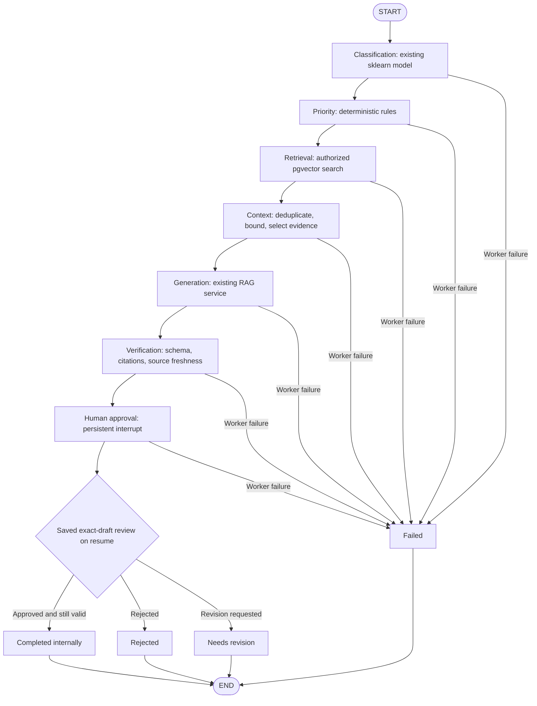

# Ticket workflow orchestration — Steps 10–11

Implemented locally on 2026-10-21. This is a real, bounded Python LangGraph
`StateGraph`, not simulated agent dialogue. Seven logical workers share existing
application services; only response generation can invoke an AI provider.

## Graph and workers



Each worker has a conditional edge: failure ends the graph; otherwise it proceeds
to the next node. There is no model-directed tool execution or graph loop. Local
abstention still flows through generation/verification to human review, but makes
**zero provider calls** and cannot be approved as an evidence-supported answer.

| Worker | Implementation and result |
| --- | --- |
| Classification | Existing `TicketClassifier.predict`; trained model/version/uncertainty metadata. Missing classifier is recorded and processing continues for manual review. No training or automatic category change. |
| Priority | `priority-rules-v1`: preserve existing priority; raise to urgent for `data breach`, `account compromised`, `active attack`; high for `service down`, `production outage`, `all users blocked`, `locked out`, `cannot log in`, `unable to sign in`. Case-insensitive phrase rules, never lower priority. Return matched rule IDs and review requirement; no confidence score or automatic mutation. |
| Retrieval | Existing tenant-scoped semantic search using at most 1,000 query characters and configured top-k. Store chunk/document IDs, content hashes and scores, not passage text. Unsafe/account-status inputs skip retrieval for local abstention. |
| Context | Reload authorized sources, verify hashes, remove duplicates, apply existing safety filters and whole-passage character budget. Persist only counts and trusted abstention reason. |
| Generation | Existing provider-neutral RAG service with prepared evidence. Stable execution UUID is the draft request ID and original requester is retained across recovery. Existing draft is reused; an ambiguous generating reservation fails closed. |
| Verification | Revalidate saved schema/statement boundaries, authorized current sources and strict citation/basic claim checks. Does not prove semantic entailment. Requires human review. |
| Human approval | Real `interrupt()` persisted to PostgreSQL. `Command(resume=True)` resumes the graph; the resume value is not a decision. Read the existing immutable review record and recheck exact draft hash, version, authorization and source/ticket freshness. |

An approved workflow records **internal completion only**. No email, customer
message, account mutation, refund, billing or other external action exists.
Rejection/revision ends this execution. Revision requires deliberate new generation
and a new review; Step 10 does not add an inline draft editor.

## Storage, startup and recovery

Pinned dependencies are LangGraph **1.2.16** and PostgreSQL checkpointer **3.2.0**.
Implementation follows the official [persistence documentation](https://docs.langchain.com/oss/python/langgraph/persistence)
and [interrupt/resume documentation](https://docs.langchain.com/oss/python/langgraph/interrupts).

From `apps/api`, with the project's own PostgreSQL available and private `.env`
configured:

```bash
export UV_CACHE_DIR=../../.cache/uv
uv run --locked alembic upgrade head
uv run --locked python scripts/workflows.py setup
```

Alembic `0008` adds `workflow_executions`, a nullable exact `statement_text` column
on existing draft citations, and the private `workflow_checkpoints` schema.
Legacy drafts remain readable. New drafts retain their original statement boundaries,
including valid multi-paragraph statements. Nothing is added to checkpoint text.
The explicit setup command runs the supported `PostgresSaver.setup()` migrations
under an advisory lock; application startup and HTTP requests never run DDL.
The runtime requires the installed checkpointer's exact schema version. Back up
before changing versions; unknown application workflow versions fail closed.
Downgrade retains checkpoint tables rather than silently deleting checkpoint history.

`PostgresSaver` uses autocommit, dict rows, bounded connection/statement timeouts,
a fixed private search path and serialization with pickle disabled and no arbitrary
application modules allowlisted. `durability="sync"` persists each transition before
the next node. Server-built thread IDs combine workspace and execution UUIDs; no
public endpoint accepts a thread ID or graph state.

Step 11 API requests persist jobs and return 202; a dedicated RQ worker invokes this
same graph. The dispatcher automatically recovers accepted/interrupted work using
PostgreSQL checkpoints and stable draft IDs. The UI exposes explicit resume for a
saved decision and recovery of legacy Step 10 executions. See
[BACKGROUND_JOBS.md](BACKGROUND_JOBS.md) for bounded retries and
[WORKER_OPERATIONS.md](WORKER_OPERATIONS.md) for mandatory worker/dispatcher startup.

A saved human decision can be resumed from a new request or API process. Current
permissions are checked again, including support-agent assignment restrictions.
The actor resuming need not be the original requester if currently authorized;
original requester identity stays fixed for generation idempotency and budgets.
Membership changes, source changes and stale approvals fail closed.

Stop is available for queued, running and paused workflows. It records a durable
cooperative cancellation request with actor/time; the worker checks safe boundaries.
An in-flight provider request may finish before cancellation is observed, but output
is discarded when cancellation is observed before publication. Draft/review history
is retained. Terminal checkpoint retention remains explicit:

```bash
uv run --locked python scripts/workflows.py prune --older-than-days 30
```

This command prunes only terminal checkpoints, keeps execution/review records,
and performs no generation. Backup, restore and production retention policy still
need operational validation.

## API and authorization

All routes are under `/api/v1/workspaces/{workspace_id}`.

| Method / route | Contract |
| --- | --- |
| `POST /tickets/{ticket_id}/workflows` | `{request_id: UUID, expected_ticket_version: int, synthetic_confirmed: bool}`; returns persisted execution, including failed state if a worker failed |
| `GET /tickets/{ticket_id}/workflows?page=1&page_size=5` | Bounded paginated history |
| `GET /workflows/{execution_id}` | Current execution with safe stage summaries and existing draft representation |
| `POST /workflows/{execution_id}/resume` | Empty `{}` only; recover an interrupted execution or resume a saved human decision |
| `POST /workflows/{execution_id}/cancel` | Empty `{}` only; stop when no active worker owns execution |
| Existing `POST /tickets/{ticket_id}/drafts/{draft_id}/review` | `{expected_version, action: approved|rejected|needs_revision}`; unchanged exact-draft approval service |

Every route requires a current server session, membership, scoped ticket access
and document-content permission. Mutations also enforce CSRF, trusted Origin,
ticket-write permission and current assignment restrictions. Viewer cannot inspect
private workflow output. Workspace, execution and ticket must match in the database;
UUID knowledge grants no access. Resume rejects submitted decisions/state. Reads
recompute current source and approval validity. Repeated starts with the same request
identity return the same execution; a mismatched payload returns 409.

Safe HTTP errors distinguish unauthenticated (401), forbidden (403), inaccessible
(404), invalid input (422), conflicts (409), limits (429) and unavailable storage
(503). A worker failure is a persisted `failed` execution with an allowlisted service
code and failed stage, never raw exception text, prompt, secret or reasoning.

## Bounds and cost controls

| Setting | Default / behavior |
| --- | --- |
| `RESOLVEFLOW_WORKFLOW_CONCURRENCY` | 2; PostgreSQL session slots shared across worker processes, range 1–4 |
| `RESOLVEFLOW_WORKFLOW_TIMEOUT_SECONDS` | 60; checked between stages, range 10–90 |
| `RESOLVEFLOW_WORKFLOW_MAX_ATTEMPTS` | Legacy inline recovery cap; background work uses JOB_MAX_ATTEMPTS per phase |
| `RESOLVEFLOW_WORKFLOW_DAILY_USER` | 20 new executions per user per UTC day, range 1–100 |
| Graph recursion limit | 16; fixed acyclic seven-node graph |
| Provider | Existing `AIProvider`; Gemini `gemini-3.6-flash` configurable through environment |
| Existing generation bounds | One provider call per execution; zero retries; 25-second timeout; 1,024 output tokens; minimal thinking; 4,000 ticket / 6,000 context characters; top-k 4 |
| Existing generation quotas | Global/workspace/user daily caps and separate concurrent generation reservations remain enforced |

Character budgets bound input size; they are not exact tokenizer measurements.
Live inference remains off by default and requires all existing free-tier, synthetic
workspace, explicit confirmation and operator opt-in gates. No paid fallback or
alternate model is selected. Embeddings and classification remain local. Tests use
synthetic credentials and deterministic generation; Step 10 made no live requests.
External LangSmith tracing is explicitly disabled around graph execution.

## UI and verification

The ticket's AI Workflow panel reads persisted execution status. It shows stage
completion/timing, classification and priority recommendations, evidence links,
draft/verification, review controls, history, loading/errors and recover/stop actions.
It polls queued/processing jobs every two seconds, stops at review/terminal state and
caps each polling session at 60 reads. It never invents progress. Approval uses the existing
review endpoint followed by resume; if resume fails, the saved decision remains
visible and can be resumed separately. The standalone response assistant remains.

Run existing local checks from the README. Workflow-specific checks are:

```bash
# apps/api; TEST_DATABASE_ADMIN_URL must target an isolated-test-capable local admin
UV_CACHE_DIR=../../.cache/uv uv run --locked pytest --run-db tests/test_workflows.py tests/test_workflow_units.py
# Full isolated browser suite after a production web build and database startup
UV_CACHE_DIR=../../.cache/uv uv run --locked python scripts/test_browser.py
```

See [PROJECT_STATUS.md](PROJECT_STATUS.md) for actual results, including real
PostgreSQL checkpoint persistence, fresh Python-process approval recovery, process
interruption around generation, tenant isolation and browser review journeys.

## Operational limits and future work

Execution now runs in dedicated RQ workers through the PostgreSQL job/outbox layer.
The graph remains acyclic and bounded; it does not choose tools autonomously.
The graph deadline is checked between stages, while RQ adds a hard per-job limit.
Cancellation remains cooperative around in-flight provider calls. Checkpoint state
and job metadata have different responsibilities; see BACKGROUND_JOBS.md.

No provider quality or factual-entailment guarantee follows from a passing fixture
test. Approval is internal only, and deployment/production hardening remain future
work. Step 11 is implemented; Step 12 has not started.
