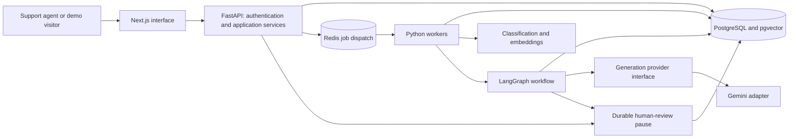

# Application architecture

Updated 2026-10-21 (Asia/Kolkata). Steps 2–10 implement the foundation described
below. The subsequent target architecture remains planned unless explicitly
listed as implemented.

## Implemented foundation — Steps 2–10

- `apps/web/`: Next.js 16.4.2 App Router, React 19.3.1, strict TypeScript 6.0.3,
  Tailwind 4.3.3 with its PostCSS plugin, and ESLint 10.13.0. Source is organized
  into routes/layout, reusable layout/home/UI components, and a typed API helper.
  Semantic color tokens support system light/dark themes. Fonts and SVG artwork
  are local/system assets; no remote font service or UI library is needed yet.
- `apps/api/`: Python 3.14, FastAPI 0.143.3, Pydantic 2.14.1, Pydantic Settings,
  and Uvicorn. `create_app` builds isolated FastAPI instances; `create_asgi_app`
  wraps the entire app in explicit-origin CORS, including server error responses.
- `GET /api/v1/health` and `GET /api/v1/info` have response schemas and OpenAPI
  documentation. `GET /api/v1/ready` checks PostgreSQL connectivity. Routers are
  thin HTTP adapters. Authentication and authorization services are implemented;
  Provider adapters and workflow orchestration are described below.
- Settings validate environment, CORS origins, docs visibility, database URL,
  and bounded database pool/timeouts.
  HTTP, validation, and unexpected errors share a safe JSON error envelope.
  Errors log their type without exposing raw exception values or request bodies.
- The development-only client health panel reads a public API origin and makes a
  bounded, uncached GET request. It validates the response contract, cancels on
  unmount, permits manual retry, and isolates failures from the rest of the page.
  CORS defaults to the two local port-3000 origins, GET only, without credentials.
- Direct dependencies are pinned; npm and uv lockfiles record transitive versions.
  Ruff and Pytest cover API behavior. TypeScript, ESLint, and the production build
  cover the initial frontend; browser verification is recorded in project status.

```text
Next.js homepage (static server-rendered content)
  └─ development-only health panel (browser)
       └─ configurable API origin → GET /api/v1/health
            └─ outer CORS middleware → versioned FastAPI router → response schema
```

The API source path is `apps/api/src/resolveflow/`. Future domain/application/infrastructure
packages will be introduced only when needed: domain rules remain provider-neutral,
application services own use cases and interfaces, infrastructure supplies adapters,
and API routes invoke those services. No empty speculative adapters are created.

For startup, configuration, stopping services, and check commands, see the
[README](../README.md).

## Implemented database foundation — Step 3

SQLAlchemy 2.x and psycopg provide synchronous request-scoped sessions. The pool
is created during app lifespan without opening a connection, uses pre-ping and
bounded timeouts, and is disposed at shutdown. Explicit commits and rollback on
exceptions keep transaction ownership with callers. The readiness query is
independent from process liveness and exposes no connection details.

PostgreSQL 18.6 runs natively on loopback port 55433 in a project-local cluster.
Alembic revisions enable pgvector 0.8.6 and create users, workspaces, memberships,
and tickets with UUID identifiers, timestamptz columns, named constraints,
restricted foreign keys, and workspace-oriented indexes. Runtime configuration
uses a non-superuser database owner; extension bootstrap uses a separate local
admin. No automatic schema changes occur on application startup.

The original four models are tenant-aware. Step 4 adds two authentication tables
and application authorization; database row-level security remains deferred. No
vector tables, embeddings, Redis, or workflow implementation is included in that database foundation.
Step 5 adds the ticket module described below. The database runbook documents timestamp behavior, extension privilege
requirements, rollback semantics, and future separation of migration/runtime roles.

See [DATABASE.md](DATABASE.md) for the schema, exact local commands, PostgreSQL
integration-test isolation, and production portability considerations.

## Implemented authentication and authorization — Step 4

Next.js `/login` and `/register` submit to an allowlisted same-origin API route
handler. It forwards bounded requests to a configurable server-only FastAPI origin.
`/app` validates the session server-side before rendering workspace data. The client
supports workspace creation/selection/settings, members and logout. Step 5 adds
the protected ticket inbox and detail routes. The public landing page retains its design and adds a sign-in link.

FastAPI uses Argon2id and PostgreSQL-backed opaque sessions. Session credentials
are hashed in storage, rotated on login/registration, expired after a fixed lifetime,
and revoked on logout. HttpOnly, host-only, SameSite=Lax cookies use Secure and the
`__Host-` prefix in production. Synchronizer CSRF tokens, exact trusted Origins,
JSON mutations (with a narrowly scoped binary document-upload exception) and Fetch Metadata rejection protect state changes. API CORS
remains GET-only without credentials; browser auth uses first-party routing.

Central authorization joins the current user to the requested workspace, enforces
role permissions, scopes target members by workspace, and serializes privileged
mutations with a workspace row lock. Owner/Admin/Support Agent/Viewer boundaries
and concurrent last-owner preservation are integration tested. Database-backed
rate counters share limits across workers without Redis; proxy users currently
share an IP budget, which requires production capacity review.

Alembic 0003 only adds auth_sessions and auth_rate_limits. Original models and
migration history are preserved. Full details and tested limitations are in
[AUTHENTICATION.md](AUTHENTICATION.md) and [AUTHORIZATION.md](AUTHORIZATION.md).

## Implemented ticket management — Step 5

An additive revision 0004 extends tickets with assigned_user_id and version, and
adds ticket_notes and ticket_activities. Composite foreign keys enforce tenant
consistency for assignment and history; original data and migrations are preserved.
Routes invoke focused command services and scoped SQL query helpers with typed
Pydantic contracts. Search/filter/sort/pagination run in PostgreSQL.

Ticket writes share the workspace lock with membership changes and recheck roles.
Versions reject stale edits; updates and their activity events commit atomically.
Demotion to Viewer or membership removal clears assignments and records events.
Notes and activities are immutable through the API, with no customer delivery.

Next.js server-gates /app/tickets and /app/tickets/[ticketId], resolves workspace
context from authorized memberships, then uses the existing same-origin session
proxy. The UI includes real forms, assignment, filters, pagination, notes/history,
loading/error states, responsive tables and permission-aware controls.
See [TICKET_MANAGEMENT.md](TICKET_MANAGEMENT.md) for precise role/lifecycle rules,
query contracts, test commands and production limitations. No AI workflow is implied
by the manual waiting_for_approval status.

## Implemented knowledge base — Step 6

Additive revision 0005 creates tenant-scoped documents and chunks with composite
foreign keys, unique content checksums and deterministic chunk identities. The
same central authorization and session proxy protect metadata, uploads, previews,
downloads, retries and deletion. Viewer access is metadata-only. The shared app
shell links tickets, knowledge and workspace settings without changing their policies.

A replaceable private storage interface uses generated keys; the local POSIX
adapter never writes to public web folders. Validation checks filenames, size,
encoding and signatures. Bounded child processes use pypdf for real digital-PDF
text and strict decoders for TXT/Markdown; paragraph-aware deterministic chunking
preserves source/page references. APIs never expose storage paths, and previews
render escaped text. There are no embeddings, vector queries or AI calls.

Processing is synchronous with explicit resource limits and document locks. A
committed metadata journal precedes file writes; chunks and completed status
commit together. Deletion uses a persistent tombstone across filesystem/DB
operations. An explicit recovery command handles interrupted processing and
partial deletion. This is not a distributed transaction or durable job queue.
See [KNOWLEDGE_BASE.md](KNOWLEDGE_BASE.md) for contracts, limits, recovery, tests,
permissions and production hardening. Future workers/object storage remain planned.

## Implemented local ML classification — Step 7

A provider-independent TicketClassifier interface has a concrete local sklearn
TF-IDF/logistic-regression implementation. Offline training uses only a versioned
280-record synthetic corpus with group-preserving stratification. Preprocessing,
training, evaluation, controlled artifact persistence and inference are separate
modules. Vocabulary and IDF are fitted only on training records. Reports retain
real metrics, split manifests, dependency versions and configuration.

The app loads one explicitly selected immutable model per lifespan/process from
private operator-controlled storage. Data-only JSON persists the fixed estimator
parameters; no pickle/joblib loading or model upload endpoint exists. Input and
batch bounds, limited concurrent calls and safe unavailable errors protect service
behavior; this is not distributed inference infrastructure or a production SLA.

POST /api/v1/workspaces/{workspace_id}/tickets/{ticket_id}/classify reads
a tenant-scoped stored ticket only after authentication, CSRF and edit permission.
It returns a recommendation, score, uncertainty and ticket/model versions without
mutating data. The UI requires manual acceptance through the existing version-checked
PATCH; dismissal makes no write, and stale acceptance returns a conflict. Viewer
and agents assigned elsewhere cannot classify. Existing free-form categories and
ticket activity semantics remain intact; no schema migration is required.

The fixed initial threshold is 0.45; scores are uncalibrated. Synthetic held-out
accuracy is 78.6%, macro F1 0.785; coverage above threshold is only 13/56. No production
accuracy claim follows. See [ML_CLASSIFICATION.md](ML_CLASSIFICATION.md) and
[ML_EVALUATION.md](ML_EVALUATION.md) for commands, measured latency, error analysis
and limitations. Step 7 itself adds no generation or retrieval; Step 8 below adds retrieval.

## Implemented semantic retrieval — Step 8

A provider-neutral EmbeddingProvider interface has a concrete offline Sentence
Transformer adapter with pinned safetensors, a private verified local snapshot,
bounded batches and full-chunk token-window aggregation. CPU inference is verified;
no paid API or generation provider is called.

Additive migration 0006 stores one vector(384) per chunk with composite tenant/source
foreign keys, model-space identity, content hash and timestamps. Separate document
indexing claims and atomic vector replacement preserve usable previous embeddings
on failure. Existing extracted chunks are indexed explicitly without re-uploading.
Deletion tombstones and cascades immediately remove content from search.

Authorized POST search embeds a bounded query and uses exact pgvector cosine SQL,
with workspace/model/source-freshness predicates before ranking. Viewer permissions
remain metadata-only. Source IDs, filenames, pages, text and similarity reach the
protected UI as escaped data. Search cannot execute document instructions.
The small synthetic corpus has measured evaluation and a lexical baseline; a future
model/dimension change requires reviewed compatibility and reindexing work.

See [SEMANTIC_SEARCH.md](SEMANTIC_SEARCH.md) for contracts and operational limits and
[RETRIEVAL_EVALUATION.md](RETRIEVAL_EVALUATION.md) for real quality/performance results.
No background workers, generated answers, Gemini, LangGraph or deployment are added.

## Implemented response generation and review — Step 9

`ai/contracts.py` defines provider-neutral structured requests/results.
`ai/providers.py` isolates the official Google GenAI SDK behind `GeminiProvider`;
a test-only deterministic adapter never substitutes for a failed real call.
The default configured model is `gemini-3.6-flash`. No live inference has
been run; cloud generation is disabled until explicit synthetic/free-tier gates
are satisfied. Embeddings remain local and independent.

`rag/service.py` reuses ticket authorization and the Step 8 retrieval service.
It reserves requests under atomic PostgreSQL budgets, constructs bounded
untrusted context, validates response schema/citations and rechecks permission,
ticket revision and source freshness before publishing a draft. Database locks
are released before provider calls. Input/context/output, concurrency, daily
request counts and retries are bounded. No tools or customer actions are exposed.

Migration `0007` adds immutable generation text/history, tenant-constrained
citations and exact-revision review audit records. Source deletion cascades
citation references while preserving historical review decisions; source hashes
and ticket versions determine current approval validity. Viewer cannot read
private document-derived drafts. Authorized editors approve, reject or request
revision through explicit CSRF-protected commands. Approval is internal only.

The existing ticket page adds plain-text draft/evidence rendering, metadata,
status/error/abstention states, history and review controls. The frontend never
receives provider credentials. Tests use real database/extraction/embeddings/
retrieval with explicitly labeled fixture generation. One separately approved
synthetic live Gemini test passed on 2026-10-20; routine live inference stays off.

The standalone Step 9 path is synchronous. Step 10 composes its provider-neutral
retrieval, prompt, validation, persistence and review services inside the genuine
LangGraph workflow described below; background dispatch remains deferred. Prompt-injection regexes and lexical
claim checks are limited safeguards, not semantic correctness guarantees.
See [RAG_PIPELINE.md](RAG_PIPELINE.md), [AI_PROVIDERS.md](AI_PROVIDERS.md),
[GEMINI_INTEGRATION.md](GEMINI_INTEGRATION.md) and [RAG_EVALUATION.md](RAG_EVALUATION.md).

## Target architecture — planned

Start with a modular backend and independently runnable frontend/API/worker
processes in one repository. Avoid premature microservices. Separate business
rules, orchestration, and infrastructure adapters so local and hosted execution
can use the same core. Foundation, classifier and local embedding versions are pinned; the Gemini generation adapter is now implemented. Durable graph orchestration is implemented in Step 10; Step 11 adds durable asynchronous dispatch.



The diagram shows the intended full local/production topology. Hosted demo
execution must be validated separately; it is not provisioned by this design.

## Planned source organization

The web, API transport, settings, schema, and API test directories now exist.
Database models/sessions and Alembic migrations now also exist.
A focused services/ package now owns auth, access policy and ticket commands. Broader
domain/application/infrastructure, workflow, ML, and worker directories remain
proposals; they have not been created.

| Path | Responsibility |
| --- | --- |
| `apps/web/` | Next.js UI, TypeScript, Tailwind, shadcn/ui; frontend tests |
| `apps/api/src/resolveflow/api/` | FastAPI transport, validation, authentication dependencies |
| `apps/api/src/resolveflow/db/` | Implemented ORM models, metadata and session lifecycle |
| `apps/api/migrations/` | Implemented, reviewed Alembic revisions |
| `apps/api/src/resolveflow/domain/` | Ticket, membership, approval, and workflow invariants |
| `apps/api/src/resolveflow/application/` | Use cases and provider/storage/job interfaces |
| `apps/api/src/resolveflow/infrastructure/` | PostgreSQL, Redis, document storage, Gemini adapters |
| `apps/api/src/resolveflow/workflows/` | Actual LangGraph graph definitions and checkpoint integration |
| `apps/api/src/resolveflow/ml/` | Classifier training/inference, embedding adapters, evaluations |
| `apps/api/src/resolveflow/workers/` | Worker entrypoints using shared application services |
| `apps/api/migrations/`, `apps/api/tests/` | Future schema history and Pytest coverage |
| `tests/e2e/`, `tests/fixtures/` | Playwright journeys and small synthetic fixtures |
| `docs/` | Architecture, plans, status, and future decisions/runbooks |

Keep the API/worker Python package shared; use uv for the current Python environment and lockfile. Select a queue
library only when background processing is in scope. Generate or validate frontend API types against the
backend contract rather than maintaining divergent request schemas.

## Component responsibilities

- **Frontend:** ticket inbox/detail, knowledge management, draft review, approval,
  and analytics. Responsive navigation, semantic controls, keyboard access, and
  explicit loading/error states are acceptance criteria. Provider keys never
  enter browser bundles. The browser has no direct database access.
- **API:** authoritative authentication, authorization, tenant scoping, input
  validation, pagination, concurrency checks, and application commands. Long
  work returns a job identifier; the UI can poll bounded status endpoints first.
- **PostgreSQL/pgvector:** durable source of truth for tickets, document versions,
  chunks/embeddings, classifications, draft revisions, approvals, audit events,
  jobs, usage reservations, and graph checkpoints. These are conceptual records,
  not a schema. Use migrations and transactions when implementation begins.
- **Redis/workers:** bounded background ingestion, embedding, classification,
  generation, and maintenance. Treat delivery as at least once; use idempotency
  keys, limited retries/backoff, job leases, and a failed-job/retry path. Durable
  database job/outbox records permit recovery if enqueueing or Redis fails.
- **ML:** reproducible scikit-learn classifier with versioned artifacts and
  confidence-aware manual fallback; sentence-transformers embedding model chosen
  after license, language, quality, size, and runtime compatibility checks.

## RAG and classification flow

1. Authorize a document upload; enforce size/type limits and safe parsing. Store
   metadata and source provenance; select portable file storage later. Never
   depend on a hosted function's local disk for durable documents.
2. A worker extracts text, chunks it, computes embeddings, and marks a document
   version ready only when ingestion completes. Scope all records to a tenant.
3. Version the embedding model, vector dimension, normalization, and chunking
   policy. A model change requires re-embedding; incompatible vectors must never
   be compared in the same retrieval index.
4. A ticket receives a classification and confidence. Low confidence routes to
   manual triage rather than an unsupported automatic decision.
5. Embed the query with the same embedding configuration and retrieve authorized
   chunks from pgvector, retaining document/version references for citations.
6. Bound context length and handle insufficient evidence explicitly. Do not
   generate invented citations. Evaluate retrieval on held-out synthetic cases.

Document deletion must remove corresponding chunks, vectors, and cached results
under a defined retention policy. Training splits must prevent related-ticket
or document leakage between training and evaluation.

## Workflow architecture requirements

Step 10 implements the bounded synchronous subset of these requirements; see the
implementation section below. Background retries, inline revisions and external
actions remain future work. The workflow must use a real compiled LangGraph graph with typed state,
conditional edges, checkpoint persistence, and interrupt/resume behavior. A
sequential wrapper labeled as a graph does not satisfy this requirement.

Planned progression:

```text
validate ticket -> classify -> retrieve evidence -> generate draft
    -> validate draft/citations -> persist draft revision -> await human review
    -> approve exact revision -> record approved action -> complete
```

Low confidence or missing evidence routes to manual handling. Provider failures
produce retryable or terminal job states. Rejection returns to an explicit
revision path with a bounded attempt count. No database transaction stays open
while awaiting a person or a network response.

Graph state carries tenant/ticket/run IDs, referenced document versions, draft
revision, and provider/model/prompt versions. Checkpoints survive process restarts;
Redis is not the sole checkpoint store. Resume must revalidate the actor's tenant
and permissions. Edits invalidate prior approval, and duplicate or stale approval
commands must not repeat actions. Approval and its audit event are atomic.

The initial demo records approval inside the product. Any eventual email/helpdesk
delivery integration requires its own authorized scope and idempotent delivery
path; generated text never authorizes external side effects by itself.

## Interchangeable AI providers

Define separate application-level generation and embedding interfaces. Generation
accepts normalized context, a response schema, deadlines, and output bounds;
returns validated content, normalized usage, provider/model identifiers, and
typed errors. Vendor SDK objects remain inside infrastructure adapters.

The initial adapter targets `gemini-3.6-flash` through the Google Gemini API.
Google documents that exact model identifier and free-tier input/output inference.
Account access, quotas, and regional eligibility still need validation before any
live call. [Model documentation](https://ai.google.dev/gemini-api/docs/models/gemini-3.6-flash),
[pricing](https://ai.google.dev/gemini-api/docs/pricing#gemini-3.6-flash).

Keep provider/model selection configurable, with capability checks for required
structured output. Switching providers may require a new adapter and prompt/eval
work, but must preserve domain and approval contracts. Do not assume that every
provider is wire-compatible. No gateway subscription or paid fallback is required.

Use a deterministic fake adapter for local development and tests without keys.
Label fixture responses clearly; a fixture run is never evidence of live inference.

## Security and no-cost demo safeguards

All items here are future implementation requirements:

- Authenticate users; authorize roles and tenant membership on every resource,
  vector query, job, approval, and analytics request. Worker context must be
  validated, not trusted merely because it came from a queue.
- Decide session/cookie, CSRF, CORS, and password/identity handling before public
  access. Restrict demo visitors to isolated synthetic workspaces with bounded
  writes and no administrative access.
- Validate and sanitize inputs/outputs. Treat retrieved instructions and model
  content as untrusted data; no arbitrary tools, SQL, code execution, URL fetches,
  or customer-facing actions may be authorized by model output.
- Keep secrets server-side, out of Git and logs. Use synthetic tickets/documents
  for the public demo. Google's pricing page marks free-tier data as eligible for
  product improvement, so real customer data is excluded from this demo design.
  [Source](https://ai.google.dev/gemini-api/docs/pricing#gemini-3.6-flash).
- Enforce atomic per-session and global request/token limits across instances,
  bounded input/context/output sizes, concurrency caps, timeouts, retry ceilings,
  and a server-side live-inference kill switch. Reserve quota before calling the
  provider; reconcile usage conservatively, including retries and uncertain calls.
- Fail closed if quota enforcement is unavailable. At limits or provider outages,
  preserve review/read access and show an honest unavailable state or explicitly
  labeled fixture mode. Do not upgrade plans, enable billing, or switch providers
  automatically. Verify the account is free-tier before enabling live use.
- Keep logs structured and redacted with request/run IDs; track latency, job
  failures, retrieval quality, approval rate, and aggregate inference usage.
  Separate auditable actions from mutable operational logs.
- Before production, establish retention/deletion, least-privilege credentials,
  migration safety, tested backups/restores, dependency review, and incident
  procedures with measurable recovery and availability objectives.

## Local development and hosted operation

**Local target:** all components run using locally installed free tooling,
PostgreSQL/pgvector, Redis, and downloaded open-source model artifacts. Routine
development/testing requires no paid API and no live Gemini key. Downloaded model
licenses and resource requirements must be checked before adoption.

**Hosted demo target:** Vercel serves the frontend for a personal non-commercial
recruiter demo. Vercel's Hobby documentation restricts that plan to personal,
non-commercial usage; it is not the selected commercial SaaS hosting plan.
[Source](https://vercel.com/docs/plans/hobby).

Vercel supports FastAPI through Python Functions, making it a possible API host.
That capability alone does not prove that our ML dependencies or worker lifecycle
fit the eventual plan. [Source](https://vercel.com/docs/frameworks/backend/fastapi).

The full-application hosting decision must validate the following before deploying
that system. The separately authorized Step 13 synthetic demo does not run these
backend workloads:

| Workload | Required evidence / unresolved decision |
| --- | --- |
| Frontend and API | Supported runtimes, function limits, routing, CORS/session behavior, cold starts and packaging |
| PostgreSQL/pgvector | Sustainable free allocation, extension availability, persistence, connection limits and recovery |
| Redis and job execution | Compatible Redis commands, durable job recovery, independently hosted workers or an explicitly agreed bounded execution adaptation |
| Embeddings/classifier | CPU/memory/model-size feasibility and live query embedding when the MacBook is offline |
| Documents and checkpoints | Durable storage, tenant isolation, quotas, backup/retention and restart recovery |
| Gemini | Actual account free-tier access, enforceable quotas, timeout behavior and disabled paid fallback |

Do not assume a request-scoped function can host a permanent Redis consumer or
that in-process background work will survive request completion. A pre-ingested
demo corpus could reduce hosting load, but it does not remove the need for hosted
query embedding, retrieval, graph execution, and review persistence. Any reduced
demo behavior must be explicitly agreed and documented.

No hosted storage/worker provider is selected. Continuous free availability has
not been established. If the full requirements cannot fit a sustainable free
arrangement, report the conflict for a user decision; do not silently introduce
paid infrastructure. A release check must run the complete recruiter journey
with the developer's laptop offline.

## Decisions still open

Future AI/ML dependency/runtime compatibility; identity recovery/verification; worker library;
embedding model/dimension; document parsing/storage; LangGraph checkpoint adapter;
classification labels/dataset; quality/performance thresholds; hosted dependencies;
demo resource caps and retention. Resolve these at the relevant implementation
phase, without provisioning future services during this foundation step.

## Implemented durable orchestration — Step 10

The `workflows` package compiles a genuine LangGraph StateGraph with classification,
priority, retrieval, context, generation, verification and human-approval nodes.
Conditional edges terminate failed work; the human node uses a persistent interrupt.
HTTP routes own authentication/input validation and call orchestration services;
no graph logic resides in Next.js. Runtime model/provider selection remains in the
existing adapter configuration. No classifier or embedding pipeline is replaced.

Alembic 0008 adds scoped execution ownership, immutable request identity and exact
statement text beside draft citations. An explicit setup command initializes the
supported PostgreSQL checkpointer inside `workflow_checkpoints`. Graph state keeps
IDs/hashes/counts and recommendations, not raw prompts, passages, drafts or secrets.
Execution rows expose safe progress; checkpoints control recovery; existing draft
and review tables control exact-revision decisions. Advisory locks serialize each
execution and enforce shared concurrency caps across API processes.

Generation reuses the RAG service and stable execution ID; ambiguous provider
reservations never retry. Approval resumes only from a persisted authorized review
and rechecks current ticket/source/hash validity. Completion is internal, with no
customer action. Server-side workspace, document-content, ticket-edit and assignment
rules apply again on resume. The browser shows actual saved stage progress and
reuses the response assistant's draft/review presentation.

Step 10 originally ran synchronously within a bounded FastAPI request. Durable
checkpoints do not imply an autonomous queue, process supervisor or automatic
restart. Step 11 now dispatches through RQ/Valkey to separate Python workers.
Production requires independently available API/database/model/document storage;
long-lived graph workers must not run in Vercel frontend serverless functions.
See [AGENT_ORCHESTRATION.md](AGENT_ORCHESTRATION.md) and
[WORKFLOW_STATE.md](WORKFLOW_STATE.md) for exact contracts and operational limits.


## Implemented background execution — Step 11

Authenticated API requests atomically persist the existing execution plus one job
row, then return 202. A separate dispatcher reconciles that PostgreSQL outbox into
RQ on local authenticated Valkey. Dedicated `SpawnWorker` processes call the existing
LangGraph orchestrator, sharing PostgreSQL checkpoints, current tenant checks, stable
draft reservations and exact human approval. Queue messages contain UUIDs only and
use JSON serialization with an allowlisted entry point.

The job record owns delivery/status/attempt metadata; graph state owns node progress
and review outcome. Database session locks bound global and per-workspace work;
worker timeouts and durable reconciliation recover crashed owners. Cancellation is
cooperative and retains requester/time history. No cross-system atomicity or exactly-once
execution is claimed. Provider failures remain fail-closed; local transient database/
retrieval failures have bounded retries. Live inference stays disabled.

The frontend shows actual queue/stage status and bounded polling. Existing document
processing and standalone RAG endpoints retain their prior behavior. The broker has
an optional Docker configuration; API, dispatcher, worker and frontend can be hosted
independently later. No production deployment or recruiter-demo execution strategy
is implemented. See [BACKGROUND_JOBS.md](BACKGROUND_JOBS.md) and
[WORKER_OPERATIONS.md](WORKER_OPERATIONS.md) for the authoritative implemented details.


## Implemented analytics and diagnostics — Step 12

A single authenticated workspace overview endpoint returns typed ticket, resolution,
workflow, job, human review and knowledge-base aggregates. The service starts a
read-only repeatable-read transaction, rechecks central `analytics:read` permission
(Owner/Admin), and uses tenant predicates on every SQL relation. Histories are validated
in PostgreSQL; no full ticket/event tables are loaded into application memory.
Creation cohorts use bounded inclusive UTC dates, while current job counts are
explicitly independent of that range. Null measurements retain sample counts/reasons.

The protected Next.js analytics page reuses AppShell/design tokens, uses pinned
Recharts for responsive trend charts and provides accessible underlying data tables.
Migration 0010 adds two workspace/date indexes and nullable job correlation IDs.
A content-free ASGI wrapper generates request IDs and timings; safe IDs follow job
acceptance into worker logs. Broker/worker topology remains available only through
operator CLI health checks. No cache, additional database, paid service or AI summary
is introduced. See ANALYTICS.md and OBSERVABILITY.md for definitions and limitations.


## Implemented recruiter demonstration — Step 13

`/demo/[[...view]]` is a separate public presentation layer using synthetic fixtures,
a typed browser-local command adapter, immutable authored workflow examples and
calculated analytics. It reuses the seven-stage `WorkflowStages` presentation and
Step 12 `AnalyticsDashboard` through an optional typed data source; authenticated
callers retain the original API loader. Design tokens/layout styles are shared.
No production ticket service, database model, provider or checkpoint logic is replaced.

Deployment mode is centrally validated. `full` remains the default; `demo` rejects
the real proxy before session or backend access. Protected server reads cannot
contact FastAPI in demo deployments. The mode cannot be selected by HTTP input.
The Next.js runtime and visitor browser are sufficient; no long-running Vercel
worker, persistent filesystem, database or AI credential is introduced.

The reserved demo generation endpoint always rejects execution; enabling public AI
is deliberately unsupported without shared abuse controls. Demonstrations remain
usable without provider quota. Authored results are not represented as live inference
or recordings from Gemini. See RECRUITER_DEMO.md, DEMO_SECURITY.md and
VERCEL_DEPLOYMENT.md for exact contracts, provenance, limits and deployment gates.


## Verified release boundary — Step 14

The Vercel project root is `apps/web`, using the Next.js preset, Node 24.x,
`npm ci`, `npm run demo:build` and default framework output. The landing page is
prerendered; the dynamic demo route uses a normal Next.js function plus browser
state. No static export, Python runtime, database, model download or long-running
worker is packaged for the demonstration. The real system above is preserved.

Local production verification used an unreachable backend origin and asserts that
all demo browser flows attempt neither API nor external network requests. Protected
routes redirect to the demo; the real API proxy returns 404 before upstream access;
the reserved generation endpoint returns 403 without reading credentials. Public
mode is build configuration, not a visitor-selected authorization bypass.

Generated traces stay within `apps/web`; their combined unique file set is about
30.6 MB, with about 1.51 MB static assets. These are local measurements, not Vercel
function bundle sizes. The remaining development-only lint advisory, security audit
scope and hosted acceptance gates are recorded in
[VERCEL_RELEASE_READINESS.md](VERCEL_RELEASE_READINESS.md). At that Step 14 gate no deployment had run. Steps 15C–15D subsequently deployed
and verified the standalone Next.js demo on Vercel Hobby. The full backend remains
local. Physical MacBook-off testing is still unperformed; hosted browser journeys
were verified independent of local services. See HOSTED_DEMO_VERIFICATION.md.
