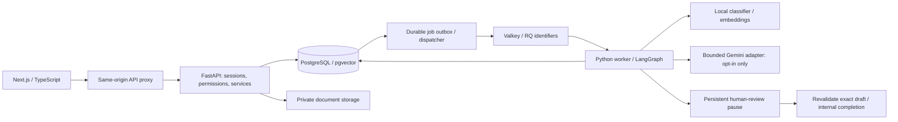

# ResolveFlow AI — portfolio technical summary

> Historical assessment retained. Step 20 current implementation, fresh verification
> and operating limits are recorded in [PORTFOLIO_EVIDENCE.md](PORTFOLIO_EVIDENCE.md),
> [SYSTEM_ARCHITECTURE_OVERVIEW.md](SYSTEM_ARCHITECTURE_OVERVIEW.md) and the
> [current readiness matrix](PRODUCTION_READINESS_MATRIX.md). Earlier pending-feature,
> deployment and advisory statements below are dated evidence, not current setup instructions.

Current assessment: 2026-10-23. Application revision
`759e5f87751cb49c1dd117755dcbdc08b14e31af`.

ResolveFlow AI explores how a support team can triage tickets, retrieve relevant
policy evidence and review a generated draft without losing control over the
answer. The implementation emphasizes explicit tenant authorization, evidence
freshness, human approval and recoverable background work. It does not send
customer messages or take account actions.

## Two intentionally different runtimes

The [public recruiter demo](https://resolveflow-ai-rosy.vercel.app/demo) runs
standalone Next.js on Vercel. It contains synthetic tickets/policies, authored
classification and draft examples, keyword search and bounded workflow replay.
Edits and decisions live in browser session storage. Live inference is disabled;
it needs no backend, PostgreSQL, queue, ML model or Gemini key.

The **full application runs locally** and implements the actual backend pipeline:

This diagram describes the local full application, not additional services hosted
inside the public demo. PostgreSQL stores graph checkpoints and durable job state;
Valkey transports work rather than serving as the authoritative job database.

## Engineering implementation

**Stack:** Next.js/React, TypeScript, Tailwind; Python/FastAPI/Pydantic;
SQLAlchemy/Alembic, PostgreSQL/pgvector; scikit-learn, Sentence Transformers;
LangGraph with PostgreSQL checkpointer; Valkey/Redis protocol and RQ workers.
Tests use Pytest and Playwright, with Ruff, TypeScript, ESLint and production builds.
shadcn/ui and Vitest remain planned, not implemented dependencies to claim.

**Classification:** a real TF-IDF/logistic-regression model is trained on a versioned
280-example synthetic dataset. Paired scenario groups stay together across the
168/56/56 split; vocabulary and model fit use training data only. Immutable
data-only JSON artifacts carry dataset/split/model/configuration provenance. The
held-out test has 44/56 correct predictions: **78.57% accuracy, 0.7846 macro F1**.
At the configured threshold only 13/56 receive a suggestion; the rest abstain.
These are small synthetic results, not real-world accuracy or calibrated confidence.

**Retrieval and RAG:** pinned local MiniLM embeddings produce 384-dimensional
vectors. PostgreSQL exact cosine search enforces workspace/model/source scope.
RAG selects bounded deduplicated passages and validates statement/citation structure,
exact supporting quotations and source freshness. The recorded 24-query synthetic
retrieval experiment has K=5 recall **0.9286** and hit rate **20/21** answerable
queries. Three negative queries abstain. Citation validity does not prove factual
entailment: fixture RAG answered all seven answerable cases with valid quotes but
covered all required terms in only three.

**Gemini:** the SDK is behind an `AIProvider` interface; model selection remains
environment-configurable and embeddings are independent. One approved synthetic
live request on 2026-10-20 verified `gemini-3.6-flash` communication, structured
schema and citation validation at minimal thinking/1,024 output-token cap,
25-second timeout and zero retries. This is not a broad live quality evaluation.
Routine tests use a deterministic test-only provider. No paid fallback is enabled.

**Orchestration and human review:** a genuine seven-node LangGraph runs classification,
rule-based priority, retrieval, context selection, generation, verification and
human approval. PostgreSQL persists synchronous checkpoints and a real review
interrupt. Resume reads an authorized saved decision bound to the exact draft
hash/revision and current ticket/sources. Completion is internal; there is no
autonomous tool selection or customer-delivery action.

**Background durability:** a PostgreSQL outbox accepts work before RQ publication.
Workers use server-resolved identifiers, JSON transport, ownership locks and delivery
tokens to reject duplicates/stale work. Broker/worker loss can recover from persisted
state. An ambiguous interrupted generation fails closed instead of making an
unapproved second call. The system is at-least-once, not an exactly-once claim.

**Security and diagnostics:** server sessions, CSRF/Origin controls, role and tenant
checks, bounded private file extraction, plain-text model rendering, safe error
categories and immutable review records are implemented. Analytics aggregate actual
workspace records with explicit cohort/denominator semantics and privileged access.
Important remaining gaps include verified membership identity, recovery/lifecycle
controls and commercial infrastructure hardening; see the audit rather than treating
these controls as a blanket security guarantee.

## Verification and honest limits

Step 18 fresh checks passed **269 backend tests, 26 full-application browser tests,
16 local demo tests and 11 hosted demo scenarios**, plus full production build,
TypeScript, ESLint and Ruff. Saved classifier evaluation reproduced exactly without
retraining the baseline. Tests use isolated marked databases and owned brokers,
actual local embeddings/pgvector, real workers/checkpoints and synthetic generation.
Fault tests exercise broker replacement, killed workers, stale citations, tenant
denial, replay and exact-draft approval recovery.

This is strong local engineering evidence, not commercial SaaS readiness. There is
no demonstrated independent backup restoration, production capacity/SLO, complete
privacy/retention program, real-user quality study or full hosted backend. Five
high development-only lint dependency findings remain tracked; no affected runtime
path was found in the recorded production trace review. Browser accessibility
checks are not complete real-device or screen-reader certification.

## Suggested presentation and source access

Start the demo with a workflow, inspect a citation, record an example review and
open **Under the hood**. Then use a local engineering walkthrough to show a real
worker pause/resume and the failure tests. Explain the separate demo runtime before
discussing ML scores or durable execution.

The [source repository](https://github.com/abhi0874/resolveflow-ai) is private.
Uninvited recruiters cannot inspect backend source, tests or these reports through
that link. Keep it private for now and consider a separately reviewed case study,
architecture diagram, recorded walkthrough or selected reviewer access. Publishing
source requires fresh secret/data/history/license review and explicit permission.
This document is local and has not been published.

Evidence: [technical audit](FINAL_TECHNICAL_AUDIT.md),
[readiness matrix](PRODUCTION_READINESS_MATRIX.md),
[ML evaluation](ML_EVALUATION.md), [retrieval report](evaluation/retrieval-v1.json),
[RAG evaluation](RAG_EVALUATION.md), and [remaining work](REMAINING_WORK.md).
