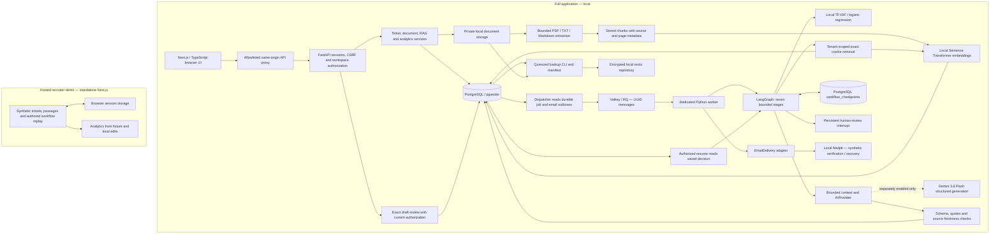

# ResolveFlow AI system architecture

Source and presentation reviewed locally on 2026-10-25, Step 23. This describes implemented code, not a
commercial deployment plan. The [public demo](https://resolveflow-ai-rosy.vercel.app/demo)
is a separate synthetic runtime. See [portfolio evidence](PORTFOLIO_EVIDENCE.md)
for verification scope and [readiness](PRODUCTION_READINESS_MATRIX.md) for gaps.

## Runtime and data flow

The dashed Gemini edge is disabled during routine operation/tests. Automated full
journeys inject a labeled deterministic provider; they still run actual database,
ML, embeddings, retrieval, graph and queue code. The demo has no connection to the
full application's backend. Diagram arrows express data flow, not every transaction
or deployment process. Document extraction/indexing remain synchronous service
operations; they are not silently represented as RQ ingestion jobs.

## Boundaries and implementation map

Paths below are under `apps/api/src/resolveflow/` unless stated otherwise.

| Boundary | Implemented responsibility |
| --- | --- |
| Next.js → FastAPI | `apps/web/src/app/api/v1/[...path]/route.ts` allowlists routes/query shapes, forwards bounded bodies and selected session/CSRF headers; server-only upstream origin |
| API → services | `api/v1/` validates Pydantic inputs; `services/auth.py` and `authorization.py` enforce current sessions, trusted origins, permissions and tenant scope |
| Transactions | `db/session.py` creates bounded, pre-ping pools; request sessions roll back on failure; services explicitly commit their units of work |
| Persistence | Alembic through `0012`; tenant relationships include composite foreign keys, ticket versions, exact draft review records and outbox state |
| Private files | `documents/storage.py` generates UUID-based keys, rejects symlinks/nonregular objects, and uses private filesystem permissions; no public upload directory |
| ML | `ml/` separates frozen dataset/splits, fitting, JSON artifact validation and bounded inference; accepted suggestions use the normal authorized ticket mutation |
| Retrieval | `retrieval/service.py` joins actual documents/chunks/vectors with workspace, model-space and content-hash predicates before ranking |
| Generation | `ai/contracts.py` defines provider-neutral typed requests/results; `ai/providers.py` contains Google SDK configuration and a test-only fixture |
| RAG | `rag/context.py`, `prompt.py`, `service.py` select evidence, reserve budgets, validate statements/quotes and reauthorize before publishing |
| Graph | `workflows/graph.py`, `workers.py`, `storage.py` implement real transitions, service calls and synchronous PostgreSQL checkpoints |
| Queue | `jobs/` persists acceptance before publication, transports identifiers through RQ, rejects stale deliveries and reconciles crashes |
| Identity email | `services/identity.py`, `email_delivery.py`, `jobs/email.py` implement expiring hash-only tokens, session revocation and bounded local SMTP delivery |
| Analytics | `analytics/` uses authorized SQL aggregates with explicit cohort dates, counts and unavailable values |
| Recovery | `backups/` verifies database/file manifests, encrypts locally, checks integrity and restores into ownership-marked isolated databases |

## Execution boundary: graph stages versus queue workers

An RQ process executes the graph; each graph node delegates to a specialized service
in `workflows/workers.py`. Nodes are logical workers, not separately deployed agents
or separate queue messages. LangGraph coordinates their sequence and failure exits;
RQ and the PostgreSQL outbox coordinate background delivery and recovery. Checkpoints
persist during execution and at human interruption, not just at the final outcome.

## Seven graph stages

Classification invokes the trained classifier; priority uses deterministic phrase
rules, not another language model. Retrieval invokes the local embedding/pgvector
service. Context reloads current sources and bounds passages. Generation calls the
existing RAG service using the execution UUID as a stable draft reservation.
Verification checks saved output and current citations. Approval persists a real
LangGraph `interrupt()`; resume reads the immutable database review rather than
trusting a decision in the resume payload.

Conditional failure/cancellation edges end this acyclic graph. Rejection or requested
revision ends the execution; a new draft requires a deliberate new request and review.
Approval records internal completion only. No customer send, refund or account action
is implemented. PostgreSQL checkpoint schema setup is explicit, not startup DDL.

## Security and reliability limits

Tenant authorization is enforced in the application, with database constraints as
additional integrity controls; PostgreSQL RLS is not implemented. Worker execution
rechecks authorization. Expensive generation releases database locks, then rechecks
permissions, ticket versions and source hashes before publishing. A citation must
refer to supplied source text, but mechanical validity does not prove entailment.

The queue is at-least-once. Delivery identities, ownership locks, stable draft IDs and
bounded retries prevent tested duplicate persistence; there is no exactly-once claim
for arbitrary partitions or external effects. SMTP acceptance is likewise not
exactly-once inbox delivery. Shared local file/model provisioning and operator-owned
processes remain part of the full application setup.

Public readiness checks PostgreSQL connectivity only. Worker/model/checkpoint health
requires additional operator checks. Automatic backups remain intentionally inactive;
independent key recovery, off-host storage and production DR remain unverified.
Production email, invitation delivery, supervision, aggregate quotas, retention,
least-privilege infrastructure and representative capacity/quality gates remain open.
